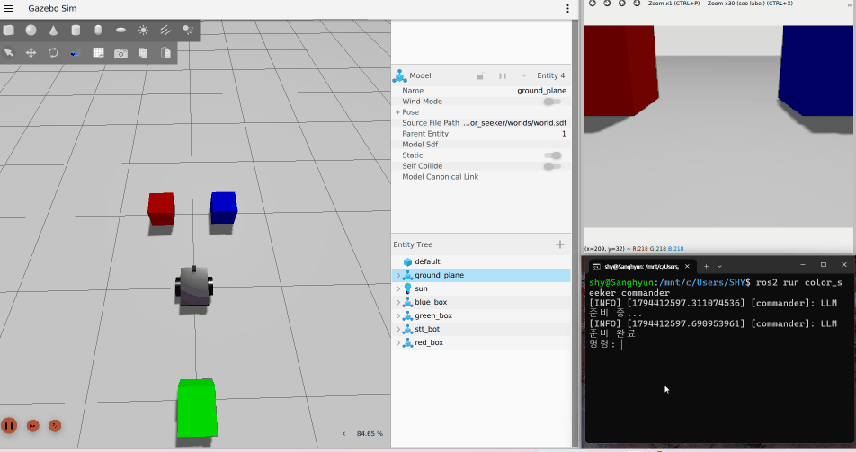
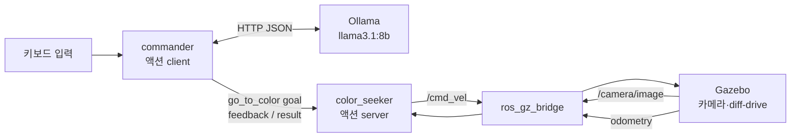

# color_seeker

**말로 시키면 그 색 물체를 찾아가는 로봇** (ROS 2 Jazzy + Gazebo Harmonic + 로컬 LLM)

> "빨간색으로 갔다가 파란색으로 가" → LLM이 `["red", "blue"]`로 해석 → 로봇이 카메라로 빨간 상자를 찾아가 멈추고, 이어서 파란 상자로 간다

<!-- TODO: GIF (Gazebo 창 + commander 터미널을 같이). 찍으면 아래 줄을 주석 밖으로

-->

## 무엇을 하나

- 키보드로 한국어 명령을 입력하면, 로컬 LLM(Ollama, llama3.1:8b)이 가야 할 색의 **목록**으로 바꾼다
- 색 하나하나를 ROS 2 **액션** goal로 보내고, 로봇은 카메라 영상만으로 그 색을 찾아 회전·직진·정지한다
- "멈춰", "그만"은 LLM을 거치지 않고 바로 취소한다. 모르는 말이면 하던 일을 계속한다
- 화면 밖에 있는 색도 전에 본 방향을 기억해 두었다가 **짧은 쪽으로** 돌아서 찾는다

## 구조



| 노드 | 역할 | 입력 | 출력 |
|---|---|---|---|
| `commander` | 문장 → 색 목록 → goal을 순서대로 | 키보드, Ollama 응답 | `go_to_color` goal / 취소 |
| `color_seeker` | 색 찾기 + 주행 | `/camera/image`, `/model/stt_bot/odometry`, goal | `/cmd_vel`, feedback(칸 수), result |

액션 인터페이스 (`color_seeker_interfaces/action/GoToColor`)
```
string color      # goal
---
bool success      # result
---
int32 pixel_count # feedback: 화면 안 목표 색 칸 수(가까울수록 커짐)
```

로봇(`urdf/robot.urdf`): 상자 몸통 + 바퀴 2개(diff-drive 플러그인) + 캐스터 + 앞쪽 카메라(320×240, 시야각 60°, 0.3 rad 아래로 숙임). URDF, world, 상자 SDF 모두 직접 작성.

## 동작 원리

**색 찾기 (사진 한 장마다, 약 25Hz)**
1. `cv2.inRange`로 목표 색 범위 안의 칸만 255인 마스크를 만든다. 범위는 Gazebo 조명에서 실제 칸 값을 재서 정했다(SDF에 `1 0 0 1`로 적은 빨강도 렌더링 결과는 R 100~116)
2. 칸이 0개면 → 회전하며 찾기 (기억한 방향이 있으면 그쪽으로)
3. 칸이 `stop_count`(49000, 화면의 약 64%) 넘으면 → 정지, 도착
4. 그 외에는 칸들의 가로 평균 `cx`로 판단: 왼쪽(< 140)이면 왼쪽 회전, 오른쪽(> 180)이면 오른쪽 회전, 가운데면 직진

**방향 기억**: 사진마다 세 색을 모두 검사해서, 보이는 색은 `현재 yaw + (160 − cx) / 320 × 시야각`을 world 기준 방향으로 저장한다. 목표가 화면 밖이면 `atan2(sin d, cos d)`로 정리한 각도 차의 부호를 보고 짧은 쪽으로 돈다(뒤쪽 빨강: 항상 왼쪽이면 3.51 rad, 지금은 2.78 rad).

**명령 해석**: Ollama `/api/generate`에 JSON schema(`format`)로 `{"colors": [enum...]}`만 답하게 강제하고, `temperature 0`으로 같은 문장엔 같은 답이 나오게 했다.

## 설계하면서 정한 것들

- **정지는 LLM보다 먼저**: "잠깐 멈춰봐"를 LLM이 `blue`로 읽은 적이 있다. 멈추라는 말에 다른 곳으로 출발하는 건 위험하므로, 정지 단어가 들어 있으면 LLM 없이 바로 취소한다(0.0004초, Ollama가 꺼져 있어도 동작). 멈추는 쪽으로 틀리는 게 안전하다
- **모르는 말은 무시**: `unknown`이면 goal을 보내지 않는다. 처음엔 새 goal 전에 이전 goal을 취소하는 구조라, 알아듣지 못한 말 한마디에 하던 일이 멈췄다
- **액션 서버와 스레드**: 단일 스레드 `spin`에서는 execute 콜백의 대기 루프가 카메라 콜백을 막아서 로봇이 전혀 움직이지 않았다 → `MultiThreadedExecutor` + 액션 서버만 `ReentrantCallbackGroup`
- **goal이 겹칠 때**: 초록으로 가는 도중 파랑을 시키면, 이전 goal의 마무리 코드가 새 goal의 상태를 덮어쓰는 버그가 서버와 client 양쪽에 있었다
  - 서버: `current_goal is not goal_handle`이면 공유 상태를 건드리지 않고 스스로 abort
  - client: `future is self.result_future`일 때만 goal 핸들을 지움
- **순차 명령**: 첫 색만 보내고 나머지는 대기열에 둔다. 결과가 **성공**일 때만 다음 색을 꺼내므로, 취소·abort되면 이어서 출발하지 않는다. 정지하면 대기열을 비운다
- **첫 명령 지연**: Ollama는 5분 동안 안 쓰면 모델을 내린다. 시작할 때 웜업 요청 + `keep_alive 30m` → 첫 명령 5.7초 → 0.47초

## 명령 해석 평가

`tools/eval_commands.py`: Gazebo 없이 로봇이 쓰는 것과 같은 `interpret()` 함수로 24문장을 채점한다. 프롬프트를 고칠 때마다 다시 돌려서 다른 문장이 깨지지 않았는지 본다. 테스트 문장은 프롬프트 예시에 넣지 않는다.

| 분류 | 예 | 결과 |
|---|---|---|
| 색 이름 | 빨간색 상자로 가 → `["red"]` | 3/3 |
| 다른 말로 된 색 | 딸기 색 상자 → `["red"]` | 4/5 |
| 부정 | 초록색으로 가지 말고 빨간색 상자로 가 줘 → `["red"]` | 3/3 |
| 정지 | 일단 기다려 → `["stop"]` | 5/5 |
| 없는 색 / 무관한 말 | 보라색 찾아 → `["unknown"]` | 4/4 |
| 순서 | 빨강, 파랑, 초록 순서로 돌아 → `["red", "blue", "green"]` | 3/4 |
| **합계** | | **22/24 (92%)**, 평균 0.18초 (RTX 5060 Ti) |

변화: 첫 버전 80% → 없는 색 규칙 추가 95%(20문장) → 순차 명령을 위해 목록 format으로 바꾸자 부정 문장이 `["green", "red"]`(가지 말라는 곳에 먼저 감)로 깨짐 → 부정 규칙을 "목록에서 완전히 빼라"로 고쳐 92%(24문장).

남은 실패 2개는 모두 "바다색"이다(`["green"]`, `["blue", "green"]`). 모델이 청록으로 읽는다. 이 문장 하나에 맞춘 규칙은 넣지 않았다.

## 실행

환경: Ubuntu 24.04 (WSL2), ROS 2 Jazzy, Gazebo Harmonic, Ollama

```bash
sudo apt install ros-jazzy-ros-gz ros-jazzy-cv-bridge
ollama pull llama3.1:8b

cd ~/ros2_ws
colcon build --packages-select color_seeker_interfaces color_seeker
source install/setup.bash

# 터미널 1: Gazebo + 로봇 + 상자 3개 + bridge + color_seeker
ros2 launch color_seeker color_seeker_launch.py

# 터미널 2: 명령 입력 (launch로 켜면 stdin이 연결되지 않아 따로 실행)
ros2 run color_seeker commander
```

명령 없이 액션만 보내기:
```bash
ros2 action send_goal /go_to_color color_seeker_interfaces/action/GoToColor "{color: 'blue'}" -f
```

해석 평가만 돌리기 (Ollama만 필요):
```bash
python3 src/color_seeker/tools/eval_commands.py
```

파라미터 (`color_seeker`, 실행 중 `ros2 param set`으로 바로 반영): `stop_count`(49000), `turn_speed`(0.3 rad/s), `forward_speed`(0.2 m/s)

## 한계

- **색 범위는 이 조명에서 잰 값**이다. 조명이 바뀌면 다시 재야 한다. 같은 색 물체가 둘이면 평균 `cx`가 그 사이 빈 곳을 가리킨다
- **거리를 모른다**: 화면 속 칸 수로 가까움을 추정한다. 물체 크기나 해상도가 바뀌면 `stop_count`를 다시 정해야 한다
- **방향 기억은 위치가 아니라 "그때 그 자리에서 본 방향"**이라 로봇이 많이 움직이면 틀려진다. odometry는 바퀴 회전을 쌓아서 계산하므로 미끄러짐이나 순간이동을 모른다
- 장애물 회피가 없다
- commander를 Ctrl+C로 끄면 진행 중인 goal이 취소되지 않는다

## 다음 (v2)

- 색 범위 → 글로 찾는 검출 모델(Grounding DINO, OWL-ViT 등): "빨간 컵"을 색이 아니라 물체로 찾기. 노드 구조(사진 → 위치 → cx → 판단 → `/cmd_vel`)는 그대로 두고 마스크 부분만 바꾼다
- 거리: 깊이 카메라나 라이다로 칸 수 대신 실제 거리로 정지
- 음성 입력(STT)

## 파일

```
color_seeker/
├── color_seeker/color_seeker.py   # 액션 서버 + 색 찾기 + 주행
├── color_seeker/commander.py      # 명령 입력 + LLM 해석 + 액션 client
├── tools/eval_commands.py         # 명령 해석 평가
├── launch/color_seeker_launch.py  # Gazebo, 로봇/상자 생성, bridge, 노드
├── urdf/robot.urdf
└── worlds/                        # world.sdf (sensors 시스템 포함), 상자 3개
color_seeker_interfaces/action/GoToColor.action
```
