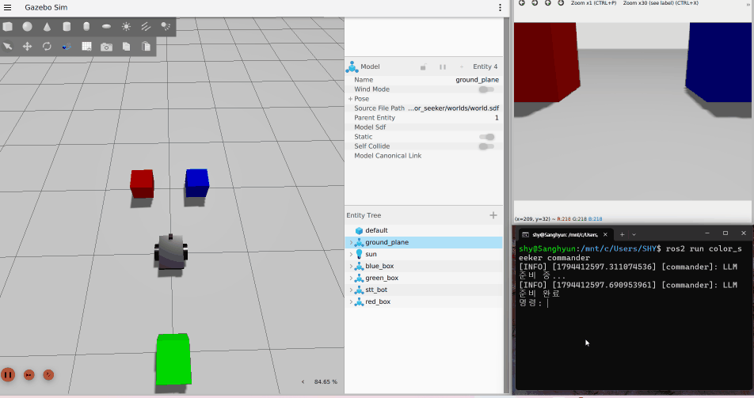
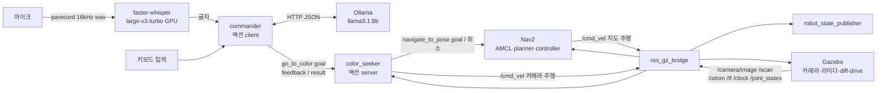

# color_seeker

**말로 시키면 그 색 물체를 찾아가는 로봇** (ROS 2 Jazzy + Gazebo Harmonic + Nav2 + 로컬 STT + 로컬 LLM)

> "빨간색으로 갔다가 파란색으로 가" → LLM이 `["red", "blue"]`로 해석 → 로봇이 카메라로 빨간 상자를 찾아가 멈추고, 이어서 파란 상자로 간다



*왼쪽: Gazebo, 오른쪽 위: 로봇 카메라 영상, 오른쪽 아래: commander. "빨간색으로 갔다가 파란색으로 가" → 빨강 도착(`4, True`) → 이어서 파랑 도착*

## 무엇을 하나

- 마이크로 말하거나 키보드로 한국어 명령을 입력하면, 로컬 STT(faster-whisper)가 글자로 바꾸고 로컬 LLM(Ollama, llama3.1:8b)이 가야 할 색의 **목록**으로 바꾼다. 인터넷 없이 PC 한 대에서 전부 돈다
- 색 하나하나를 ROS 2 **액션** goal로 보내고, 로봇은 카메라 영상만으로 그 색을 찾아 회전·직진·정지한다
- 찾는 방법은 두 가지 중 실행할 때 고른다: **색 마스크**(OpenCV, 기본) 또는 **글로 찾는 검출 모델**(OWLv2, open-vocabulary detection: `"red box"`라는 글로 물체를 찾음)
- "멈춰", "그만"은 LLM을 거치지 않고 바로 취소한다. 모르는 말이면 하던 일을 계속한다
- 화면 밖에 있는 색도 전에 본 방향을 기억해 두었다가 **짧은 쪽으로** 돌아서 찾는다. 기억한 방향에 없으면 기억을 지우고 다시 찾는다
- **방 두 개짜리 world에서 지도 위치를 기억하고 Nav2로 간다**: 카메라(어느 방향) + 라이다(몇 m) + tf(로봇이 지도 어디)로 본 상자의 지도 위치를 적어 두고, 시키면 Nav2로 상자 앞까지 간 뒤 카메라가 마무리한다. 한 번도 못 본 색은 둘러보기 지점으로 Nav2 이동하며 찾고, 가는 도중 보이면 목적지를 그 상자 앞으로 바꾼다

## 구조



| 노드 | 역할 | 입력 | 출력 |
|---|---|---|---|
| `commander` | (음성 → 글자) → 문장 → 색 목록 → goal을 순서대로 | 마이크 또는 키보드, Ollama 응답 | `go_to_color` goal / 취소 |
| `color_seeker` | 찾기(색 마스크 또는 OWLv2) + 위치 기억 + Nav2 지시 + 마지막 카메라 주행 | `/camera/image`, `/odom`, `/scan`, tf `map → base_link`, goal | `/cmd_vel`, `navigate_to_pose` goal, feedback, result |
| `robot_state_publisher` | URDF + 바퀴 각도 → 부품 tf | `/joint_states` | `/tf`, `/tf_static` |
| Nav2 (`nav2_bringup`) | 저장한 지도에서 위치 추정(AMCL), 경로 계획, 장애물 피해 주행 | `/scan`, `/odom`, `/tf`, 지도 | `/cmd_vel`, tf `map → odom` |

Nav2가 운전하는 동안 `color_seeker`는 카메라 주행을 끄고(`target_color = None`) 손을 떼서, 두 쪽이 `/cmd_vel`을 동시에 보내지 않는다.

액션 인터페이스 (`color_seeker_interfaces/action/GoToColor`)
```
string color               # goal
---
bool success               # result
---
int32 pixel_count          # feedback: 화면 안 목표 색 칸 수(가까울수록 커짐)
string state               # feedback: searching / navigating / approaching
float32 distance_remaining # feedback: navigating일 때 Nav2가 알려 준 남은 경로 길이(m)
```

로봇(`urdf/robot.urdf`): 상자 몸통 + 바퀴 2개(diff-drive 플러그인) + 캐스터 + 앞쪽 카메라(320×240, 시야각 60°, 0.3 rad 아래로 숙임) + 위쪽 라이다(360칸, 0.12~10m, 바퀴·카메라에 가리지 않게 받침 위 0.13m). URDF, world, 상자 SDF 모두 직접 작성.

world(`worlds/world.sdf`): 4m × 4m 방 두 개(방 A x −2 ~ 2, 방 B x 2 ~ 6)를 칸막이로 나누고 1m 문 하나. 파랑 (1.0, −0.4), 초록 (−1.0, 0)은 방 A, 빨강 (4.5, −1.0)은 방 B라서 출발점(원점)에서는 칸막이에 가려 안 보인다. 지도(`maps/room.*`)는 slam_toolbox로 만들었다.

## 동작 원리

**사진 → 숫자 두 개 (detector에 따라 둘 중 하나)**

사진 한 장에서 `area`(얼마나 크게 보이나 = 가까움)와 `cx`(가로 어디에 있나, 0~319) 두 숫자만 뽑는다. 아래 판단은 두 방법이 같은 코드를 쓴다.

- `detector:=color` (기본): `cv2.inRange`로 목표 색 범위 안의 칸만 255인 마스크를 만들고, `cv2.connectedComponentsWithStats`로 붙어 있는 칸끼리 덩어리로 나눠 **가장 큰 덩어리 하나**의 칸 수(`area`)와 가운데(`cx`)를 쓴다. 범위는 Gazebo 조명에서 실제 칸 값을 재서 정했다(SDF에 `1 0 0 1`로 적은 빨강도 렌더링 결과는 R 100~116)
- `detector:=owlv2`: OWLv2(`google/owlv2-base-patch16-ensemble`)에 사진과 글 세 개(`"red box"`, `"blue box"`, `"green box"`)를 **한 번에** 넣고, 글마다 점수가 가장 높은 사각형 하나를 고른다. `area` = 사각형 가로 × 세로, `cx` = 사각형 가운데. 찾을 이름과 모델에 넣을 글은 딕셔너리(`target_texts`) 하나로 정해서, 물체를 바꿀 때 글만 바꾸면 된다

**판단**
1. `area`가 0이면 → 회전하며 찾기 (기억한 방향이 있으면 그쪽으로)
2. `area`가 `stop_count`(49000, 화면의 약 64%) 넘으면 → 정지, 도착
3. 그 외에는 `cx`를 world 기준 목표 방향으로 바꿔 저장만 한다: `목표 yaw = 찍었을 때 yaw + (160 − cx) / 320 × 시야각`

**회전·직진은 odometry 콜백에서 (약 41Hz)**: 저장된 목표 yaw와 지금 yaw의 차이가 ±0.065 rad(화면 ±20칸) 밖이면 그쪽으로 회전, 안이면 직진. 사진 판단이 느려도 몸은 빠른 루프로 조종한다(아래 "검출은 느리고 몸은 빠르게")

**방향 기억**: 사진마다 세 색을 모두 찾아서(color는 색마다 마스크, owlv2는 위의 모델 한 번), 보이는 색은 `찍었을 때 yaw + (160 − cx) / 320 × 시야각`을 world 기준 방향으로 저장한다. goal이 없을 때도 기억한다. 목표가 화면 밖이면 `atan2(sin d, cos d)`로 정리한 각도 차의 부호를 보고 짧은 쪽으로 돈다(뒤쪽 빨강: 항상 왼쪽이면 3.51 rad, 지금은 2.78 rad). 기억한 방향에 도착했는데(각도 차 0.1 rad 미만) 여전히 안 보이면 그 기억을 지우고 한 방향으로 돌며 다시 찾는다.

**지도 위치 기억 (Nav2)**: 방향 기억은 "그 자리에서 본 방향"이라 로봇이 움직이면 틀려진다. 그래서 보이는 색은 지도 위치도 같이 적는다.
1. 카메라: `angle = (160 − cx) / 320 × 시야각` (정면 0, 왼쪽 +)
2. 라이다: 같은 각도의 칸 `round((angle − angle_min) / angle_increment)`에서 거리 `d` (라이다도 정면 0, 반시계 +라서 각도를 그대로 쓴다)
3. tf `map → base_link`: 로봇의 지도 위치 `(rx, ry, ryaw)`
4. 상자 위치 = `(rx + d·cos(ryaw + angle), ry + d·sin(ryaw + angle))` → `seen_pos[색]`

원점에서 본 파랑은 (0.85, −0.34)로, 상자 앞면(x 0.85)과 맞는다. 다가가는 동안에도, 반대쪽에서 봐도 5cm 안에서 같은 값이 나온다. 사진마다 세 색을 모두 적으므로 goal이 없을 때나 Nav2가 운전하는 중에도 기억이 쌓인다.

**goal 하나의 흐름**
1. 기억이 있으면 → 로봇에서 상자로 향하는 방향 `yaw = atan2(by − ry, bx − rx)`로, 상자에서 로봇 쪽으로 0.6m 앞 `(bx − 0.6 cos yaw, by − 0.6 sin yaw)`에 Nav2 goal(상자를 바라보는 방향까지)
2. Nav2 도착 후, 또는 기억이 없으면 → 카메라로 찾기·다가가기(위의 판단)
3. 기억 없이 `search_time`(10초) 동안 못 찾으면 → 둘러보기 지점(방 B 가운데 (4.0, 0.0))으로 Nav2 이동. 가는 동안 그 색이 `seen_pos`에 생기면 Nav2를 취소하고 1번처럼 상자 앞으로 다시 Nav2
4. 둘러보기 지점을 다 돌았는데 없으면 abort

Nav2가 가는 동안에도 0.1초마다 go_to_color의 취소 요청과 새 goal을 확인해서, 있으면 Nav2 goal까지 취소한다. feedback은 0.5초마다 `navigating`과 남은 거리를 보낸다.

**음성 입력**: `명령:`에서 Enter만 치면 `parecord`로 녹음을 시작하고, 다시 Enter를 치면 녹음을 끝내 faster-whisper(`large-v3-turbo`, GPU, `int8_float16`)로 글자로 바꾼다. 그 글자는 키보드로 친 문장과 똑같이 아래 해석으로 간다. 짧은 명령 하나에 약 0.2초.

**명령 해석**: Ollama `/api/generate`에 JSON schema(`format`)로 `{"colors": [enum...]}`만 답하게 강제하고, `temperature 0`으로 같은 문장엔 같은 답이 나오게 했다.

## 설계하면서 정한 것들

- **정지는 LLM보다 먼저**: "잠깐 멈춰봐"를 LLM이 `blue`로 읽은 적이 있다. 멈추라는 말에 다른 곳으로 출발하는 건 위험하므로, 정지 단어가 들어 있으면 LLM 없이 바로 취소한다(0.0004초, Ollama가 꺼져 있어도 동작). 멈추는 쪽으로 틀리는 게 안전하다
- **모르는 말은 무시**: `unknown`이면 goal을 보내지 않는다. 처음엔 새 goal 전에 이전 goal을 취소하는 구조라, 알아듣지 못한 말 한마디에 하던 일이 멈췄다
- **액션 서버와 스레드**: 단일 스레드 `spin`에서는 execute 콜백의 대기 루프가 카메라 콜백을 막아서 로봇이 전혀 움직이지 않았다 → `MultiThreadedExecutor` + 액션 서버만 `ReentrantCallbackGroup`
- **goal이 겹칠 때**: 초록으로 가는 도중 파랑을 시키면, 이전 goal의 마무리 코드가 새 goal의 상태를 덮어쓰는 버그가 서버와 client 양쪽에 있었다
  - 서버: `current_goal is not goal_handle`이면 공유 상태를 건드리지 않고 스스로 abort
  - client: `future is self.result_future`일 때만 goal 핸들을 지움
- **순차 명령**: 첫 색만 보내고 나머지는 대기열에 둔다. 결과가 **성공**일 때만 다음 색을 꺼내므로, 취소·abort되면 이어서 출발하지 않는다. 정지하면 대기열을 비운다
- **commander를 꺼도 로봇이 멈추게**: 처음엔 Ctrl+C로 commander를 끄면 서버의 goal이 살아서 로봇이 계속 갔다. rclpy 기본 Ctrl+C 처리기는 `finally`에 닿기 전에 rclpy를 먼저 꺼 버려서(`context is invalid`) 취소를 보낼 수 없었다 → `SignalHandlerOptions.NO`로 끄는 시점을 직접 정하고, 취소 → 응답 대기(최대 1초) → executor shutdown → 스레드 join → 노드 정리 순서로 종료. 순서가 틀리면(spin 스레드가 도는 중에 노드 정리) 10번 중 8번 `Aborted`
- **같은 색 물체가 둘일 때**: 처음엔 마스크 전체 칸의 평균 `cx`를 썼다. 빨간 상자 둘을 좌우 대칭으로 두면 cx가 159.5(정확히 가운데)가 되어 로봇이 두 상자 사이 빈 곳으로 직진했고, 둘 다 화면 밖으로 놓친 뒤 우연히 하나를 다시 찾았다 → 덩어리로 나눠 가장 큰 것만 따라가게 바꿈. 8950칸과 8958칸 중 큰 쪽으로 돌기 시작하면 그 상자가 계속 커져서 선택이 바뀌지 않는다
- **첫 명령 지연**: Ollama는 5분 동안 안 쓰면 모델을 내린다. 시작할 때 웜업 요청 + `keep_alive 30m` → 첫 명령 5.7초 → 0.47초
- **STT는 로컬로**: 클라우드 스트리밍 STT도 생각했지만, 로봇 명령은 2~3초짜리 짧은 말이라 말이 끝난 뒤 0.2초면 체감 차이가 거의 없다. 로컬로 두면 인터넷·API 키·요금이 필요 없고 음성이 밖으로 나가지 않는다. Whisper도 시작할 때 1초 무음으로 웜업한다(첫 변환 0.52초 → 0.18초). faster-whisper의 결과는 꺼낼 때 계산되므로 웜업도 `list(segments)`로 끝까지 꺼낸다
- **무음 환각**: 아무 말 없이 녹음을 끝내자 Whisper가 `다음 영상에서 만나요.`를 지어냈다(영상 자막으로 학습해서 생기는 현상). `vad_filter=True`로 목소리가 있는 구간만 남기자 빈 글자가 되었고, 빈 글자면 goal을 보내지 않는다
- **키보드도 남겨 둠**: Enter만 치면 음성, 글자를 치면 키보드. 마이크가 없거나 테스트할 때, 급하게 멈출 때 쓴다
- **오래된 방향 기억**: 파랑 → 빨강 → 파랑 순서로 시키면, 세 번째 파랑에서 로봇이 제자리에서 좌우로 떨기만 했다. 기억한 파랑 방향은 파랑 근처에서 본 것이라 빨강 앞에서는 그쪽에 파랑이 없었고, 각도 차가 0 근처에서 +/−를 오가며 왼쪽·오른쪽 명령을 번갈아 보냈다. 안 보이니 기억을 고칠 기회도 없었다 → 기억한 방향에 왔는데 안 보이면 기억을 지운다. 같은 순서에서 약 22초 만에 도착

- **검출은 느리고 몸은 빠르게**: OWLv2 한 번이 약 0.35초라서, 처음 구조(사진 콜백이 cx를 보고 바로 회전 명령)에서는 판단 사이에 마지막 명령을 계속 따라 목표를 지나쳤다. 모델 대신 사진 콜백에 `time.sleep(0.35)`를 넣어 재현해 보니, 원점에서 파랑까지 5초 걸리던 것이
  - 사진 구독 큐 깊이 10: 18.5초(쌓인 예전 사진으로 판단해서 cx가 277 → 54로 반대쪽 끝까지 지그재그)
  - 큐 깊이 1: 10초(가장 최근 사진만 봄. 남은 원인은 판단 한 번에 0.35초씩 회전을 계속하는 것)
  - **검출은 world 기준 목표 방향만 저장, 회전은 odometry 콜백(41Hz)이 맡게 분리**: 5초. cx는 277 → 96 → 203처럼 오가도 목표 yaw는 −0.38 근처(−0.33 ~ −0.44)로 유지된다. 상자는 world에 고정이라 "찍었을 때 yaw"를 기준으로 바꾸면 로봇이 돌아도 같은 숫자가 나온다
  - 실제 OWLv2로 잰 판단 간격(0.32~0.38초)이 sleep 값과 같아서 이 결론이 그대로 맞았다
- **콜백 그룹**: 같은 기본 콜백 그룹이면 사진 콜백이 0.35초를 잡고 있는 동안 odometry 콜백이 한 번도 안 불렸다(41Hz인데 0번). 두 구독에 각각 `MutuallyExclusiveCallbackGroup()`을 주자 그 사이 14~15번 불렸다. 사진 구독을 Reentrant로 하면 검출이 동시에 여러 개 돌기 때문에 쓰지 않았다
- **모델은 사진당 한 번**: 처음엔 방향 기억(세 색)과 목표 찾기(한 색)에 모델을 따로 돌렸다. 글 세 개를 한 번에 넣고 결과를 `found = {이름: (점수, 사각형)}`에 모아 두 곳이 같이 쓰게 했다. 글이 1개에서 3개로 늘어도 시간은 거의 같다(계산 대부분이 사진 쪽)
- **pipeline 대신 직접 호출**: `transformers.pipeline`은 글마다 따로 돌아서 0.52초 → `Owlv2Processor` + `Owlv2ForObjectDetection`으로 글을 한 번에 넣어 0.27초(Gazebo를 켜면 0.35초. CPU에서 사진을 960×960으로 준비하는 데 0.12초, GPU 계산 0.15초)
- **점수는 글마다 크기가 다르다**: 원점에서 같은 사진에 red box 0.325, blue box 0.091(기본 threshold 0.1이면 파랑이 빠짐). 하나의 기준으로 자르지 않고 threshold 0.05로 넓게 받은 다음 글마다 가장 높은 점수 하나만 쓴다. 가운데에 크게 보일수록 점수가 올라간다(파랑 0.09 → 0.80, 빨강 정면 0.94)
- **아주 가까우면 못 찾는다**: 상자가 화면을 거의 채우면 OWLv2가 `found: {}`를 낸다. 처음엔 도착 직후 area 0 → "찾기" 갈래가 회전 명령을 보내서, SUCCEEDED 후에도 제자리에서 계속 돌았다 → 도착하면 사진 콜백이 바로 return하고 정지 명령을 보낸다
- **detector는 읽기 전용 파라미터**: 모델은 `__init__`에서 한 번 불러온다. 실행 중 `ros2 param set detector owlv2`가 성공해도 모델은 안 불려 오는 조용한 실패가 있어서 `read_only=True`로 막았다. launch 인자 `detector`(choices color/owlv2, 기본 color: torch 없이도 돌게)로 켤 때 고른다

**Nav2 연결**

- **Nav2가 느렸던 원인 (67초 → 7초)**: Nav2 기본 설정으로 0.9m 가는 데 67초가 걸렸다. rosbag으로 controller 출력(`/cmd_vel_nav`), smoother 뒤, 최종 `/cmd_vel`, 실제 속도를 1초 단위로 비교하니 명령은 손실 없이 전달되고 controller(MPPI)가 처음부터 한계의 1/10 속도만 냈다. 계산 부하(batch_size 2000 → 1000: 그대로 67초)와 inflation(0.7 → 0.3: 114초) 가설은 실험으로 배제했다. RotationShim을 넣자 회전 속도가 0.16에 고정됐는데, 이 값이 `max_angular_accel 3.2 × 주기 0.05초`, 즉 "매번 지금 속도 0에서 출발"한 값이었다. controller는 현재 속도를 `/odom`에서 읽는데 Gazebo odometry는 `/model/stt_bot/odometry`에 있었다(`/odom`에는 Subscriber만 있고 에러 없음) → bridge에서 `/odom`으로 remap하자 7.3초. tf(`odom → base_link`)와 속도 토픽(`/odom`)은 따로라서 tf만 맞아서는 안 됐다
- **멀리는 Nav2, 마지막은 카메라**: Nav2 목표를 상자 0.6m 앞으로 줘도 `xy_goal_tolerance 0.25` 때문에 0.85m에서 끝날 수 있다. 어차피 마지막 조준과 정지는 카메라가 하므로 Nav2 허용 오차를 줄이지 않았다
- **본 위치를 지도 기준으로**: 상자 위치 계산에는 tf `map → base_link`를 쓰고, 카메라 주행(목표 yaw와 회전)은 odometry yaw를 그대로 쓴다. 같은 기준끼리 빼야 해서 둘을 섞지 않았다. odometry는 벽에 긁히면 바퀴만 돌아서 크게 틀어지는데(실측: 벽에 걸린 채 2.10 rad로 기록, 실제 −0.01), AMCL의 `map → odom`이 이를 고쳐 준다
- **Nav2 이동 중 취소**: 처음엔 Nav2 결과를 기다리는 동안 go_to_color 취소가 무시되어 최대 20초 동안 안 멈췄다 → 기다리는 루프에서 0.1초마다 `is_cancel_requested`와 `current_goal`을 보고 Nav2 goal도 취소. 취소 직후 남은 코드가 카메라 주행을 0.5초 다시 켜는 버그(로그에 칸 수 `0` 한 줄)는 `continue`로 맨 위 취소 처리로 바로 보내 막았다
- **보이면 카메라로 바꾸기는 느렸다**: 둘러보는 도중 목표가 보이면 Nav2를 끄고 카메라로 다가가게 했더니 오히려 41초 → 45초가 됐다. 문 근처에서 멀리(칸 수 209) 본 상자까지 카메라가 0.2 m/s로 약 20초 직진했고(Nav2는 0.4 m/s), 카메라 주행은 지도·장애물을 안 봐서 칸막이 너머로 비스듬히 보였다면 부딪혔을 것이다 → 보이면 **목적지만 상자 앞으로 바꾸고 운전은 Nav2**에 맡김: 32초, 카메라는 칸 수 17866(가까이)부터 3초
- **취소와 새 goal의 경쟁**: 목적지를 바꾼 직후 새 Nav2 goal이 0.2초 만에 ABORTED(status 6)됐다. Nav2 로그 시각을 맞춰 보니 새 goal(0.697)보다 이전 goal의 취소(0.717)가 늦게 도착해 bt_navigator가 지금 돌고 있는 새 goal을 끊었다(`Aborting handle`). `cancel_goal_async()`는 요청만 보내고 기다리지 않는다 → 이전 goal의 결과가 올 때까지(0.1초) 기다린 뒤 새 goal

## 찾는 시간 줄이기

같은 조건(launch 새로 켜고 2D Pose Estimate, 원점에서 빨강, `time ros2 action send_goal ...`)에서 하나씩 바꾸고 재었다. 빨강은 방 B에 있어서 원점에서 안 보인다.

| 바꾼 것 | 원점 → 빨강 | 이어서 초록 (방 B → 방 A) |
|---|---|---|
| 기준: 30초 제자리 찾기 → 둘러보기 Nav2 → 카메라 | 64.6초 | ABORTED (방 B에서 초록이 안 보임) |
| 1. 목표 색뿐 아니라 **보이는 색은 다 위치 기억** (goal 없을 때, Nav2 중에도) | 68.5초 (변화 없음, 예상대로) | 32.2초 (기억으로 바로 Nav2) |
| 2. **찾을 때만 빨리 돌기** (1.0 rad/s, 조준은 0.3 그대로) + 기다림 30 → 10초 | 약 41초 | |
| 3. 둘러보다 보이면 카메라로 바꾸기 | 45.2초 ✗ (위 설명) | |
| 3'. 둘러보다 보이면 **Nav2 목적지를 상자 앞으로** | **32.0초** | **28.8초** |

32초의 내용: 원점 찾기 10초 → 둘러보기 Nav2 10.5초 → 보임 → 이전 goal 취소 0.1초 → 상자 앞 Nav2 6.7초 → 카메라 3초. 찾기와 조준 속도를 나눴기 때문에 1.0 rad/s로 돌다가 목표를 봐도 지나치지 않는다(cx 319 → 175 한 방향).

## 두 detector 비교

같은 world, 원점(yaw 0)에서 출발. 숫자는 이 PC(RTX 5060 Ti)와 이 장면에서 잰 값.

| | color (마스크) | owlv2 (검출 모델) |
|---|---|---|
| 찾는 기준 | 색 범위(조명에서 직접 잰 BGR 값) | 글(`"blue box"`) |
| 판단 간격 | 약 0.04초 (카메라 25Hz에 맞춰짐) | 약 0.35초 (모델이 정함, 약 3Hz) |
| 시작 | 바로 | 모델 불러오기 + 웜업 3~6초 |
| 원점에서 파랑 cx | 277.4 | 275.4 |
| 원점에서 파랑 area | 8958 (칸 수) | 10010 (사각형이라 모서리 밖 바닥까지 담음) |
| 기억한 파랑 방향 | −0.384 rad | −0.378 rad (실제 −0.381) |
| 원점 → 파랑 도착 | 약 5초 | 약 5초 |
| 원점 → 초록 멈춘 거리 (몸통 앞면 ~ 상자 면) | 약 27cm | 약 18cm (3번 18.0~18.8) |
| 아주 가까울 때 | 계속 보임 | 못 찾음 (도착 처리로 막음) |

owlv2가 더 가까이 멈추는 건 판단이 늦기 때문으로 보인다: 0.2 m/s로 가면서 판단 간격 0.35초 동안 약 7cm, 사진도 0.35초 전 것이라 합치면 최대 약 14cm를 더 간다. `stop_count`는 두 방법 모두 49000 그대로다.

## 명령 해석 평가

`tools/eval_commands.py`: Gazebo 없이 로봇이 쓰는 것과 같은 `interpret()` 함수로 24문장을 채점한다. 프롬프트를 고칠 때마다 다시 돌려서 다른 문장이 깨지지 않았는지 본다. 테스트 문장은 프롬프트 예시에 넣지 않는다.

| 분류 | 예 | 결과 |
|---|---|---|
| 색 이름 | 빨간색 상자로 가 → `["red"]` | 3/3 |
| 다른 말로 된 색 | 딸기 색 상자 → `["red"]` | 4/5 |
| 부정 | 초록색으로 가지 말고 빨간색 상자로 가 줘 → `["red"]` | 3/3 |
| 정지 | 일단 기다려 → `["stop"]` | 5/5 |
| 없는 색 / 무관한 말 | 보라색 찾아 → `["unknown"]` | 4/4 |
| 순서 | 빨강, 파랑, 초록 순서로 돌아 → `["red", "blue", "green"]` | 3/4 |
| **합계** | | **22/24 (92%)**, 평균 0.18초 (RTX 5060 Ti) |

변화: 첫 버전 80% → 없는 색 규칙 추가 95%(20문장) → 순차 명령을 위해 목록 format으로 바꾸자 부정 문장이 `["green", "red"]`(가지 말라는 곳에 먼저 감)로 깨짐 → 부정 규칙을 "목록에서 완전히 빼라"로 고쳐 92%(24문장).

남은 실패 2개는 모두 "바다색"이다(`["green"]`, `["blue", "green"]`). 모델이 청록으로 읽는다. 이 문장 하나에 맞춘 규칙은 넣지 않았다.

## 실행

환경: Ubuntu 24.04 (WSL2), ROS 2 Jazzy, Gazebo Harmonic, Ollama

```bash
sudo apt install ros-jazzy-ros-gz ros-jazzy-cv-bridge pulseaudio-utils python3-pip
sudo apt install ros-jazzy-navigation2 ros-jazzy-nav2-bringup ros-jazzy-slam-toolbox
ollama pull llama3.1:8b

# STT (시스템 파이썬에 설치: ros2 run이 /usr/bin/python3를 쓰기 때문)
#  - numpy<2: cv_bridge가 numpy 1.x 기준으로 빌드되어 있음
#  - av==16.1.0: faster-whisper 1.2.1이 넘기는 metadata_errors 인자가 av 19에서 없어짐
#  - cuBLAS, cuDNN: GPU로 돌릴 때 필요한 CUDA 라이브러리
pip install --user --break-system-packages faster-whisper==1.2.1 "numpy<2" nvidia-cublas-cu12 "nvidia-cudnn-cu12==9.*"
pip install --user --break-system-packages "av==16.1.0" --only-binary=:all:

# ~/.bashrc 맨 아래 (ROS source 줄 아래, 기존 값 뒤에 붙임)
export LD_LIBRARY_PATH=$HOME/.local/lib/python3.12/site-packages/nvidia/cublas/lib:$HOME/.local/lib/python3.12/site-packages/nvidia/cudnn/lib:$LD_LIBRARY_PATH

cd ~/ros2_ws
colcon build --packages-select color_seeker_interfaces color_seeker
source install/setup.bash

# (detector:=owlv2를 쓸 때만) 검출 모델
#  - torch는 cu128 빌드: RTX 50 시리즈(compute capability 12.0)는 이 빌드만 동작
#  - brotli>=1.2: 시스템 brotli 1.1.0이면 모델을 받다가 `process() takes no keyword arguments`
pip install --user --break-system-packages torch --index-url https://download.pytorch.org/whl/cu128
pip install --user --break-system-packages transformers==5.23.0 "brotli>=1.2"

# 터미널 1: Gazebo + 로봇 + 상자 3개 + bridge + color_seeker
ros2 launch color_seeker color_seeker_launch.py                    # 색 마스크
ros2 launch color_seeker color_seeker_launch.py detector:=owlv2    # 검출 모델 (처음엔 모델을 내려받음)

# 터미널 2: Nav2 (저장한 지도 + 이 로봇에 맞춘 설정)
ros2 launch nav2_bringup bringup_launch.py \
  map:=$(ros2 pkg prefix color_seeker)/share/color_seeker/maps/room.yaml \
  params_file:=$(ros2 pkg prefix color_seeker)/share/color_seeker/config/nav2_params.yaml \
  use_sim_time:=true

# 터미널 3: RViz → 상단 "2D Pose Estimate"로 로봇이 지금 있는 곳(원점, +x 방향)을 찍기
rviz2 -d /opt/ros/jazzy/share/nav2_bringup/rviz/nav2_default_view.rviz --ros-args -p use_sim_time:=true

# 터미널 4: 명령 입력 (launch로 켜면 stdin이 연결되지 않아 따로 실행)
ros2 run color_seeker commander
```

2D Pose Estimate를 찍기 전에는 AMCL이 `map → odom`을 올리지 않아서 지도 위치를 못 구하고, Nav2도 goal을 거절한다. Nav2 없이 켜거나 2D Pose Estimate 전이면 카메라로 `search_time`(10초) 동안만 찾고, 그 안에 못 찾으면 둘러보기 Nav2가 실패해서 abort된다(원점에서 보이는 파랑·초록은 카메라만으로 도착).

끌 때는 Nav2(터미널 2)를 먼저, Gazebo(터미널 1)를 나중에 끈다. Gazebo가 먼저 꺼지면 Nav2가 Ctrl+C에도 잘 안 꺼진다.

`명령 (Enter만 치면 음성):`에서
- Enter → 말하기 → Enter: 음성 명령
- 글자 입력 → Enter: 키보드 명령

마이크 확인 (WSL2는 WSLg를 통해 Windows 마이크가 `RDPSource`로 보임):
```bash
pactl list sources short
parecord --channels=1 --rate=16000 ~/mic_test.wav   # 말하고 Ctrl+C
paplay ~/mic_test.wav
```

명령 없이 액션만 보내기:
```bash
ros2 action send_goal /go_to_color color_seeker_interfaces/action/GoToColor "{color: 'blue'}" -f
```

해석 평가만 돌리기 (Ollama만 필요):
```bash
python3 src/color_seeker/tools/eval_commands.py
```

파라미터 (`color_seeker`, 실행 중 `ros2 param set`으로 바로 반영): `stop_count`(49000), `turn_speed`(0.3 rad/s, 조준), `search_turn_speed`(1.0 rad/s, 안 보일 때 찾기), `forward_speed`(0.2 m/s), `search_time`(10초, 이만큼 못 찾으면 둘러보기). `detector`(color/owlv2)는 읽기 전용이라 launch 인자로만 고른다

판단 간격은 사진 콜백 맨 위에서 직전 호출과의 차이를 debug 로그로 찍어 잰다(throttle 붙은 로그 간격으로 재면 1초로 보여서 틀린다)

## 한계

- **색 범위는 이 조명에서 잰 값**이다(color). 조명이 바뀌면 다시 재야 한다
- color 모드의 방향 기억은 아직 그 색 칸 전체의 평균으로 잰다. 같은 색 물체가 둘이면 기억한 방향이 둘 사이를 가리킨다(주행은 가장 큰 덩어리를 따라가서 영향은 화면 밖에서 찾을 때만). owlv2는 글마다 점수가 가장 높은 사각형 하나라 이 문제가 없다
- **owlv2는 goal이 없어도 사진마다 모델을 돌린다**(방향 기억 때문). GPU를 계속 쓴다
- owlv2의 `area`는 사각형 넓이라 실제로 보이는 칸보다 크다. 지금은 `stop_count`를 color와 같이 쓴다
- **정지는 아직 칸 수로 한다**: 라이다 거리는 위치 계산에만 쓰고, 멈추는 기준은 화면 속 칸 수(`stop_count`)다. 물체 크기나 해상도가 바뀌면 다시 정해야 한다
- **방향 기억은 "그때 그 자리에서 본 방향"**이라 로봇이 많이 움직이면 틀려진다. 지도 위치 기억이 있으면 Nav2로 상자 앞까지 가서 영향이 줄었지만, 카메라로만 찾는 구간(2D Pose Estimate 전, Nav2 없이)에서는 틀린 기억을 지우고 항상 왼쪽으로 돈다
- **위치 기억은 노드가 살아 있는 동안만**: 파이썬 딕셔너리라 다시 켜면 처음부터 다시 둘러본다. 물체가 옮겨지면 옛 위치로 갔다가 카메라로 다시 찾는다(마지막으로 본 시각, 도착해서 확인하는 처리는 없음)
- **둘러보기 지점은 손으로 정한 하나**(방 B 가운데). 지도에서 안 가 본 곳을 자동으로 고르지 않는다
- **장애물 회피는 Nav2 구간만**: 마지막 카메라 주행(약 0.6~0.85m)은 지도와 라이다를 안 보고 직진한다
- 기억한 위치로 가는 Nav2 도중에는 목표가 보여도 그대로 간다(이미 상자 앞이 목적지라 바꾸지 않음)
- **음성 "멈춰"는 키보드보다 느리다**: Enter → 말하기 → Enter라서 녹음 시작부터 취소까지 약 2초. 로봇이 이미 도착한 뒤에 취소가 갈 때도 있다. 급하면 키보드로 `멈춰`
- **잘못 들은 말을 LLM이 또 해석한다**: "파란 거로 가"를 Whisper가 `타란 타란 거로가.`로 듣자 LLM이 색이 없는 문장에서 `["red", "blue", "green"]`을 지어냈다. 오류가 STT와 LLM 두 단계에서 쌓인다

## 다음

- ~~색 범위 → 글로 찾는 검출 모델~~: OWLv2로 완료(`detector:=owlv2`). 다음은 상자가 아닌 물체(컵 등)와 LLM이 색 대신 물체 이름을 고르게 하기
- ~~위치 기억 + Nav2~~: 완료. 다음은 기억을 파일로 저장(다시 켜도 유지), 마지막으로 본 시각, 도착해서 없으면 기억 지우기
- 거리: 칸 수 대신 라이다 거리로 정지
- 시작 위치: 2D Pose Estimate 대신 `nav2_params.yaml`의 `set_initial_pose`
- 음성: 두 번째 Enter 대신 VAD로 말이 끝나면 자동으로 녹음 끝내기, Whisper에 자주 쓰는 단어(빨간, 파란, 초록, 멈춰) 힌트 주기, 잘못 들었을 때 되묻기

## 파일

```
color_seeker/
├── color_seeker/color_seeker.py   # 액션 서버 + 찾기(color/owlv2) + 주행
├── color_seeker/commander.py      # 명령 입력(음성/키보드) + LLM 해석 + 액션 client
├── tools/eval_commands.py         # 명령 해석 평가
├── tools/stt_test.py              # 마이크 녹음 → 글자 (ROS 없이)
├── tools/save_frame.py            # /camera/image 한 장 → /tmp/frame.png
├── tools/detect_test.py           # 사진 한 장에 OWLv2 (pipeline)
├── tools/detect_fast.py           # 사진 한 장에 OWLv2 (직접 호출, 시간 재기)
├── color_seeker/nav_client.py     # navigate_to_pose client 연습 (좌표 하나로 Nav2)
├── launch/color_seeker_launch.py  # Gazebo, 로봇/상자 생성, bridge, robot_state_publisher, 노드
├── config/nav2_params.yaml        # Nav2 설정 (base_link, RotationShim + MPPI)
├── config/slam_params.yaml        # 지도 만들 때 slam_toolbox 설정
├── maps/room.pgm, room.yaml       # 방 두 개 지도
├── urdf/robot.urdf                # 카메라 + 라이다
└── worlds/                        # world.sdf (방 두 개, sensors 시스템 포함), 상자 3개
color_seeker_interfaces/action/GoToColor.action
```
